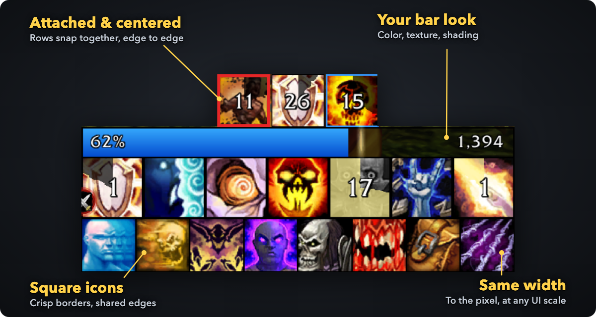

# Cooldown Manager Extras



**Blizzard's Cooldown Manager, with the options it's missing. You set it up where you
already do: in Edit Mode and in Cooldown Settings.**

This add-on adds no frames of its own and no options window to learn. The icons, bars and
Personal Resource Display stay Blizzard's. The extra options show up in Blizzard's own
panels, so the Cooldown Manager looks and works the way you know, with much more you can
change.

## Why this add-on

Most cooldown add-ons hide Blizzard's frames, draw their own, and make you set up
everything again in their own window. This add-on does not:

- **The same frames.** What Blizzard tracks, in which order, with which icons, stays as
  you set it in Cooldown Settings.
- **The same places.** Select a cooldown viewer or the Personal Resource Display in Edit
  Mode, and its settings panel has the new options. Open Cooldown Settings, and a **+**
  tile next to Blizzard's spells adds your own.
- **Built in, not bolted on.** Your own spells, trinkets, potions and buffs join
  Blizzard's icons in the same viewer, in the same look, at the place you pick. No extra
  bar to place next to it.
- **Pixel-perfect.** Borders are drawn in whole screen pixels, and attached frames line
  up edge to edge, at any UI scale. No blurry borders, no 1-pixel gaps.

Made for WoW Forever.

## Features

### Layout and anchoring

- **Center a row,** or let it grow from its left or right edge. Rows of buffs close the
  gaps of inactive icons.
- **Drag to attach.** In Edit Mode, drag a frame next to another one. A preview shows
  where it will attach; let go and it attaches. Hold Shift to move it freely.
- **Attach to anything in Edit Mode:** other viewers, the Personal Resource Display,
  action bars, unit frames, the cast bar and add-on frames, on any side, with a gap.
- **Width matching:** make a viewer, the Tracked Bars or the Personal Resource Display
  as wide as another one.
- **Pixel-perfect:** attached frames and matched widths line up to the pixel, at any UI
  scale.

### Your own cooldowns and buffs

- **Custom spells and items** in Essential or Utility Cooldowns: any spell, item
  (potions, healthstones) or trinket slot. Add them with the **+** tile in Cooldown
  Settings, or drop a spell or item on it.
- **Custom buffs** in Tracked Buffs: buffs your own trinkets, potions and spells start.
  Pick from the ones you have started, with their duration.
- **Also in combat:** the game hides buffs from add-ons in combat, so these are timed
  from your cast. That is why only buffs you start yourself can be added: buffs from other
  players and passive procs can't be shown in combat, so the add-on doesn't offer them.

### Look

- **Square icons** with pixel-exact borders, icon zoom, square cooldown swipes and an
  optional inner shadow. Debuff-type colors (Magic, Curse, ...) stay visible on the
  border.
- **Per-spell borders:** right-click a spell in Cooldown Settings to give it its own
  border color.
- **Fonts and textures** for timers, counts and bars (LibSharedMedia and Blizzard
  textures), and a square bar style.
- **Keybind text** on cooldown icons, read from Blizzard's action bars.

### Personal Resource Display

- Separate textures for the health and power bars.
- Health in class color or your own color.
- A color for each power type: turquoise mana, if you like.
- Texture and color for the cast cost preview.
- A square style: crisp border, background and inner shadow. Shading gives the bars a
  soft top-to-bottom gradient.
- Turn off the spend flash and the full-power glow.
- A five-second rule spark on the mana bar.

### Spell behavior

- **Show the cooldown, not the buff duration,** per spell, for spells that put a buff on
  you.
- **Gray out during a debuff,** per spell, for example Power Word: Shield while you have
  Weakened Soul.
- **Debuff timers** in Tracked Buffs, also in combat.

### Profiles and other add-ons

- **Profiles:** share a setup between characters and talent groups, and import or export
  it as text.
- **Masque:** not needed, and not built in. If you already skin the Cooldown Manager with
  Masque (through Masque Blizzard Bars), that keeps working: the icon look is then the
  skin's, and everything else here still works. For a similar look without Masque, use
  the Square style with an inner shadow; it stays pixel-perfect.

## Commands

- `/cme` lists the commands. `/cme options` opens profiles and import/export.
- `/cme status`, `/cme probe`, `/cme timers`, `/cme rings` and `/cme blocked` print what
  the add-on sees, for bug reports.
- `/cme probe spell|item|slot|aura <id>` shows what the game lets add-ons read about one
  cooldown or buff right now. Run it in combat.

`/cmp` works too.

## Development

The tests run outside the game, against a mock of the WoW client:

```sh
luajit tests/run.lua
```

See [tests/README.md](tests/README.md).

### Releasing

Push a version tag. GitHub Actions runs the tests, then
[BigWigsMods/packager](https://github.com/BigWigsMods/packager) builds the zip and uploads
it to CurseForge and GitHub Releases.

```sh
git tag v0.1.0
git push origin v0.1.0
```

Tags with `alpha` or `beta` in them are uploaded as alpha or beta files.

## License

MIT. The bundled [LibEditMode](https://github.com/p3lim-wow/LibEditMode) keeps its own
license (`Libs/LibEditMode/LICENSE.txt`).
