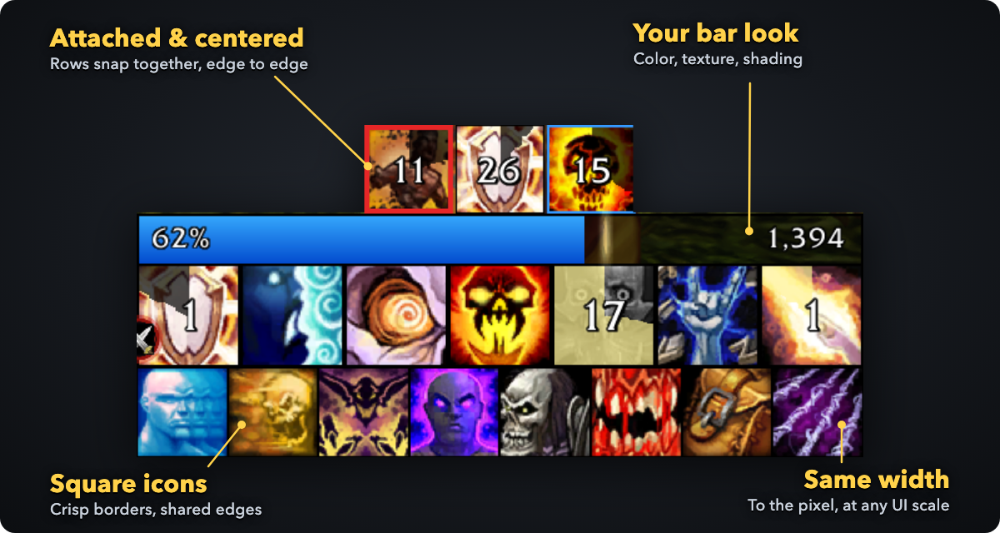
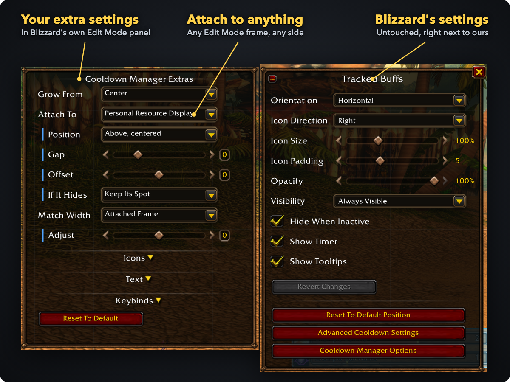
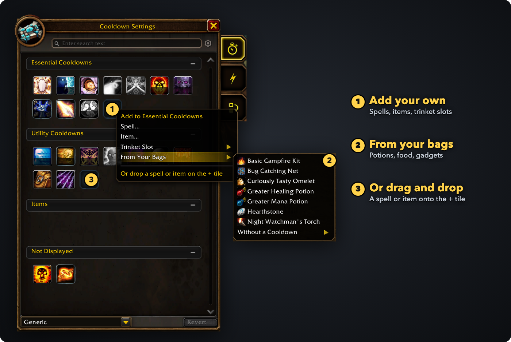
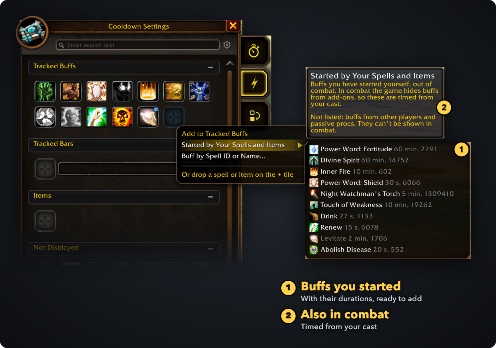
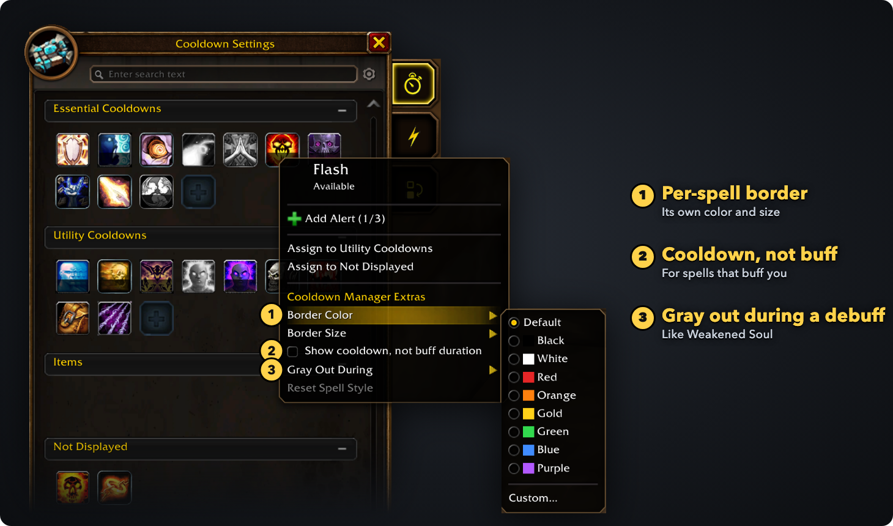

<!--
CurseForge project description. Paste into the description editor in Markdown mode.

Images load from GitHub after docs/screenshots/ is pushed to main:
  https://raw.githubusercontent.com/darfink/CooldownManagerExtras/main/docs/screenshots/<file>
Every image below matches a row in docs/screenshots/SHOTLIST.md.
-->

# Cooldown Manager Extras

**Blizzard's Cooldown Manager, with the options it's missing.** You set it up where you
already do: in Edit Mode and in Cooldown Settings. No replacement frames, no new options
window to learn.

- **The same frames:** what Blizzard tracks, the order and the icons stay as you set them.
- **The same places:** the new options are in Blizzard's own panels.
- **Built in, not bolted on:** your own spells, trinkets, potions and buffs join
  Blizzard's icons in the same viewer, in the same look. No extra bar to place.
- **Pixel-perfect:** crisp borders in whole screen pixels, and frames that line up
  edge to edge at any UI scale. No blurry borders, no 1-pixel gaps.

Made for WoW Forever.

---

## Features

### Everything in Edit Mode

Select a cooldown viewer or the Personal Resource Display in Edit Mode. The extra
settings are in its settings panel, next to Blizzard's own.

### Drag to attach

- Drag a frame next to another one. A preview shows where it will attach. Let go and it
  attaches.
- Attach to anything in Edit Mode: viewers, the Personal Resource Display, action bars,
  unit frames, the cast bar, add-on frames.
- Hold **Shift** to move a frame freely.
- Match widths, center rows, and line everything up to the pixel at any UI scale.

### Your own spells, items and trinkets

- Click the **+** tile in Cooldown Settings to add any spell, item (potions,
  healthstones) or trinket slot to Essential or Utility Cooldowns.
- Or drop a spell or item from your spellbook or bags on the tile.
- They show in Blizzard's row, at the place you pick.

### Buffs from your trinkets, potions and spells

- Add a buff your own trinket, potion or spell starts to Tracked Buffs. Pick from the
  ones you have started, with their durations.
- Also in combat: the game hides buffs from add-ons in combat, so these are timed from
  your cast.

### Square icons and clean borders

- Pixel-exact borders, icon zoom, square cooldown swipes and an optional inner shadow.
- Debuff-type colors (Magic, Curse, ...) stay visible on the border.
- Right-click a spell in Cooldown Settings to give it its own border color.
- Keybind text from your action bars, and your own fonts.

### Personal Resource Display

- Separate textures for the health and power bars.
- Health in class color or your own color.
- A color for each power type: turquoise mana, if you like.
- Texture and color for the cast cost preview.
- A square style: crisp border, background and inner shadow. Shading gives the bars a
  soft top-to-bottom gradient.
- Turn off the spend flash and the full-power glow.
- A five-second rule spark on the mana bar.

### Smarter spells

- **Show the cooldown, not the buff duration,** per spell.
- **Gray out during a debuff,** for example Power Word: Shield while you have Weakened
  Soul.
- **Debuff timers** in Tracked Buffs, also in combat.

### Profiles

- Share a setup between characters and talent groups.
- Import or export it as text with `/cme options`.

---

## FAQ

**Does it replace Blizzard's Cooldown Manager?**
No. The frames are Blizzard's. This add-on adds options to them.

**Where are the settings?**
In Edit Mode: select a viewer or the Personal Resource Display. Custom spells and buffs
are in Cooldown Settings. Profiles and import/export are in `/cme options`.

**Why can't I add a buff from another player, or a passive proc?**
In combat the game hides buffs from add-ons. A buff your own spell or item starts can be
timed from your cast. A buff from another player or a passive proc ("chance on hit")
can't: nothing tells an add-on that it started. The add-on only offers what it can also
show in combat.

**Do I need Masque?**
No. The Square style with an inner shadow gives a similar look, and it stays
pixel-perfect. If you already skin the Cooldown Manager with Masque (through Masque
Blizzard Bars), that keeps working: the icon look is then the skin's, and layout,
anchoring, fonts and per-spell borders still work. Masque skins icons only, not the
Personal Resource Display.

**Something looks wrong. What do I send?**
Open an issue on GitHub with the output of `/cme status`. For script errors, type
`/console scriptErrors 1` and include the complete error text.

---

## Links

- [Source and issues on GitHub](https://github.com/darfink/CooldownManagerExtras)
- [Latest release](https://github.com/darfink/CooldownManagerExtras/releases/latest)
